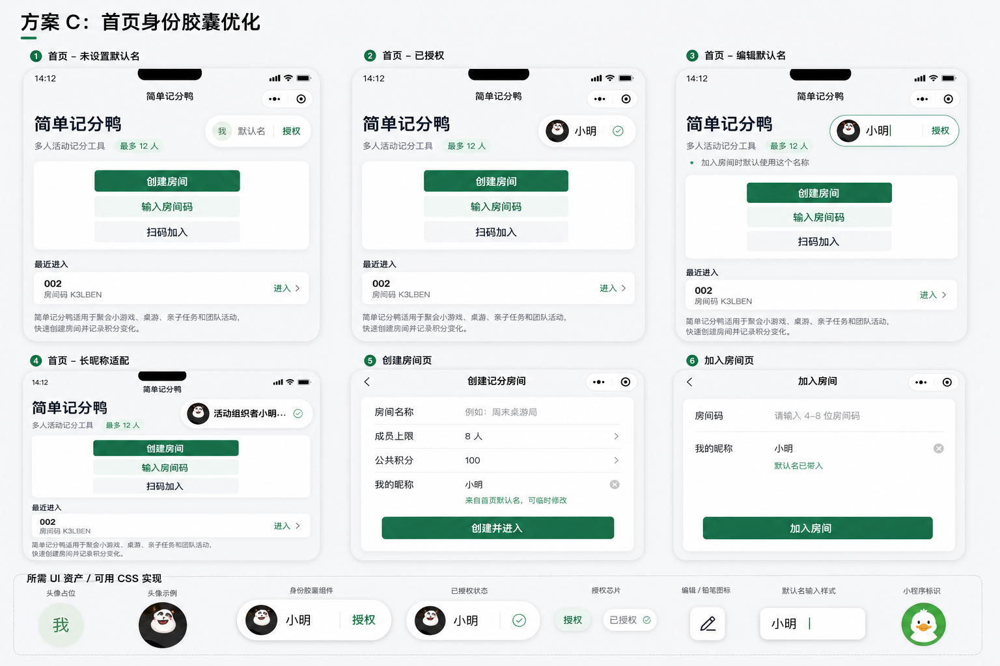
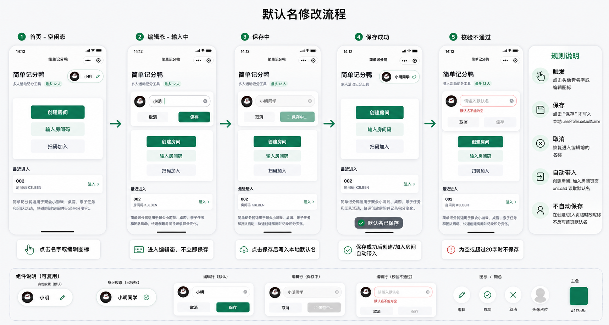

# 首页身份胶囊 UI 计划

版本：v0.1  
日期：2026-06-24  
状态：已按方案 C 执行，待微信开发者工具真实预览验收

## 1. 背景

首页需要展示当前用户，并允许用户设置本地默认名。该默认名在创建房间和加入房间时自动带入。

当前真实预览中的问题：

1. 身份胶囊占位过宽，头像与胶囊比例不稳定。
2. 名称编辑触发点不清楚，用户不知道点击哪里修改。
3. 保存时机不清楚，用户不知道是输入即保存，还是点击确认后保存。
4. 当前首页已经有主要操作卡片，身份信息不能抢占创建和加入房间入口。

本计划基于已选定的方案 C：标题区右侧身份胶囊。

## 2. 设计目标

1. 当前用户信息在第一屏可见，但不打断创建、加入、扫码三个主入口。
2. 身份胶囊必须在 iPhone 12/13 宽度下不溢出、不挤压标题、不出现竖排文字。
3. 默认名修改必须有明确的触发、编辑、保存、取消和错误状态。
4. 创建房间页和加入房间页只读取首页默认名，不反写首页默认名。
5. 所有新增 UI 资源先用于审查，审查通过后再进入实现。

## 3. 方案图

### 3.1 方案 C 总览



用途：展示首页、创建房间页、加入房间页和资源组件的整体方向。

### 3.2 默认名修改流程



用途：展示默认名从触发编辑到保存成功、校验失败的完整交互。

## 4. UI 状态拆分

### 4.1 首页默认态：未设置默认名

位置：`pages/index/index`

页面结构：

1. 左侧标题区：
   - `简单记分鸭`
   - `多人活动记分工具`
   - `最多 12 人`
2. 右侧身份胶囊：
   - 圆形头像占位，显示 `我`
   - 名称区域显示 `默认名`
   - `授权` 小按钮
3. 主操作卡片：
   - `创建房间`
   - `输入房间码`
   - `扫码加入`
4. 最近房间和说明文案保持现有顺序。

交互：

1. 点击头像：触发微信头像选择。
2. 点击 `授权`：触发微信资料授权。
3. 点击名称或编辑图标：进入默认名编辑态。

### 4.2 首页默认态：已授权

身份胶囊显示：

1. 微信头像。
2. 默认名，例如 `小明`。
3. 已授权状态使用小勾图标或弱化文字，不再使用强按钮。

长名称规则：

1. 胶囊整体宽度固定上限。
2. 名称单行展示。
3. 超出时省略，不挤压标题和主操作卡片。

### 4.3 首页编辑态：正在修改默认名

触发：

1. 点击身份胶囊里的名称。
2. 点击身份胶囊里的编辑图标。

UI：

1. 身份胶囊展开为紧凑编辑条。
2. 编辑条包含：
   - 头像
   - 默认名输入框
   - `取消`
   - `保存`
3. 输入框获得焦点。
4. 下方可显示轻提示：`加入房间时默认使用这个名称`。

保存规则：

1. 输入时不立即保存。
2. 点击 `保存` 后写入本地 `userProfile.defaultName`。
3. 保存成功后回到已授权或已设置默认名的胶囊态。
4. 保存成功提示：`默认名已保存`。

取消规则：

1. 点击 `取消` 后恢复进入编辑态前的名称。
2. 不写入本地缓存。

### 4.4 首页编辑态：校验失败

校验规则：

1. 默认名不能为空。
2. 默认名最多 20 个字符。

UI：

1. 输入为空时，`保存` 禁用。
2. 输入不合法时显示红色提示。
3. 不写入本地缓存。

提示文案：

```text
默认名不能为空
默认名最多 20 个字符
```

### 4.5 保存中

UI：

1. 输入框和按钮临时禁用。
2. `保存` 按钮显示 `保存中`。
3. 防止连续点击。

说明：

当前默认名只写本地缓存，通常很快完成。仍保留保存中状态，保证交互完整。

### 4.6 创建房间页

位置：`pages/create-room/index`

UI：

1. `我的昵称` 默认填入首页默认名。
2. 字段下方显示轻提示：`来自首页默认名，可临时修改`。

行为：

1. 用户在创建页修改昵称，只影响本次创建房间。
2. 不反写首页默认名。
3. 提交时传递 `nickname` 和 `avatarUrl`。

### 4.7 加入房间页

位置：`pages/join-room/index`

UI：

1. `我的昵称` 默认填入首页默认名。
2. 字段下方显示轻提示：`默认名已带入，可临时修改`。

行为：

1. 用户在加入页修改昵称，只影响本次加入房间。
2. 不反写首页默认名。
3. 提交时传递 `nickname` 和 `avatarUrl`。

## 5. 资源清单

### 5.1 设计图

| 资源 | 路径 | 用途 |
| --- | --- | --- |
| 方案 C 总览图 | `docs/assets/home-profile/home-profile-c-design-board.png` | 审查整体页面和状态 |
| 默认名修改流程图 | `docs/assets/home-profile/default-name-edit-flow.png` | 审查编辑触发、保存和校验 |

### 5.2 组件资产

| 资源 | 路径 | 用途 | 实现建议 |
| --- | --- | --- | --- |
| 头像占位 | `docs/assets/home-profile/avatar-placeholder.svg` | 未授权或无头像时显示 | 可用 CSS 实现，SVG 仅作设计参考 |
| 授权胶囊 | `docs/assets/home-profile/auth-chip.svg` | 授权入口 | 优先使用按钮样式实现 |
| 已保存/已授权状态 | `docs/assets/home-profile/check-chip.svg` | 成功状态提示 | 可用 CSS + 文本或图标实现 |
| 小鸭标识 | `docs/assets/home-profile/duck-mark.svg` | 头像或品牌占位参考 | 暂不放入运行包，待审查 |
| 编辑图标 | `docs/assets/home-profile/edit-pencil.svg` | 默认名编辑入口 | 优先使用轻量图标或文字按钮 |
| 身份胶囊 | `docs/assets/home-profile/profile-capsule.svg` | 胶囊比例参考 | 使用 WXML + WXSS 实现 |
| 保存按钮状态 | `docs/assets/home-profile/save-state-chip.svg` | 编辑态保存按钮参考 | 使用按钮样式实现 |

## 6. 实现计划

### 6.1 第一步：调整首页状态模型

新增页面状态：

```text
profileEditing
profileDraftName
profileOriginalName
profileSaving
profileError
```

保留现有本地资料结构：

```text
userProfile.defaultName
userProfile.avatarUrl
```

### 6.2 第二步：重构首页身份区

目标：

1. 标题区左侧固定为产品信息。
2. 右侧显示身份胶囊。
3. 编辑态在标题区下方展开紧凑编辑条，不改变主操作卡片内部结构。

需要修改：

```text
miniprogram/pages/index/index.wxml
miniprogram/pages/index/index.wxss
miniprogram/pages/index/index.js
```

### 6.3 第三步：补齐默认名保存逻辑

规则：

1. 点击编辑入口后复制当前默认名到草稿。
2. 输入只更新草稿。
3. 点击保存后校验并写入本地缓存。
4. 保存成功后退出编辑态。
5. 点击取消后丢弃草稿。

### 6.4 第四步：创建和加入页提示

目标：

1. 显示默认名来源提示。
2. 明确临时修改不反写首页默认名。

需要修改：

```text
miniprogram/pages/create-room/index.wxml
miniprogram/pages/create-room/index.wxss
miniprogram/pages/join-room/index.wxml
miniprogram/pages/join-room/index.wxss
```

### 6.5 第五步：文档同步

若审查通过并进入实现，需要同步：

1. `docs/architecture.md`：补充默认名编辑状态和保存规则。
2. `docs/requirements.md`：补充默认名的触发和保存说明。
3. `docs/codex-feedback-log.md`：记录人工审查结果和真实预览结果。

## 7. 当前情况改进方案

基于当前截图，优先改进以下点：

1. 胶囊从右侧大椭圆改为更小的身份入口，不承载完整编辑行为。
2. 默认态只显示头像、名称和编辑入口，授权状态弱化，不让按钮抢主入口视觉。
3. 编辑行为下沉到展开态，避免默认态空间不足。
4. `最多 12 人` 保持在副标题旁，避免和身份胶囊争抢右侧空间。
5. 创建、加入和扫码按钮保持当前居中和宽度策略，不随身份区重构而变动。

## 8. 自查

### 8.1 产品目标

- [x] 仍然定位为多人活动记分工具。
- [x] 没有新增高风险功能。
- [x] 默认名只用于房间内显示名，不改变积分、权限或房间关系。

### 8.2 UI 风险

- [x] 方案图覆盖未设置、已授权、编辑、保存、校验失败和长名称状态。
- [x] 默认态不再使用会撑宽的三列大卡片。
- [x] 保存规则明确为点击保存后写入本地缓存。
- [x] 创建页和加入页临时改名不反写首页默认名。
- [ ] 仍需微信开发者工具真实预览确认胶囊不溢出、不竖排。

### 8.3 资源风险

- [x] 设计图放在 `docs/assets/home-profile/`，不进入小程序运行包。
- [x] SVG 组件资产仅作为审查和实现参考。
- [x] 当前实现可优先使用 WXSS 绘制，避免引入不必要图片资源。

### 8.4 文档风险

- [x] 本文档说明状态、资源和实现计划。
- [x] 本文档未要求立即实现。
- [x] 用户已要求开始执行计划，代码实现已进入首页、创建页和加入页。

## 9. 待审查问题

1. 默认态是否保留 `授权` 文案，还是改成只显示编辑图标和头像？
2. 编辑态是否接受“展开编辑条”，还是必须进入独立弹窗？
3. 保存成功是否需要 toast，还是只回到胶囊状态即可？
4. 小鸭标识是否进入正式 UI，还是只保留为头像占位备选？
5. 创建页和加入页是否需要显示“来自首页默认名”的提示？

## 10. 本次交付自查结果

资源存在性：

```text
docs/assets/home-profile/home-profile-c-design-board.png
docs/assets/home-profile/default-name-edit-flow.png
docs/assets/home-profile/avatar-placeholder.svg
docs/assets/home-profile/auth-chip.svg
docs/assets/home-profile/check-chip.svg
docs/assets/home-profile/duck-mark.svg
docs/assets/home-profile/edit-pencil.svg
docs/assets/home-profile/profile-capsule.svg
docs/assets/home-profile/save-state-chip.svg
```

以上资源均已存在。

自动检查：

```powershell
node --check cloudfunctions\scoreFunctions\index.js
node --check miniprogram\utils\api.js
node --check miniprogram\utils\profile.js
node --check miniprogram\pages\index\index.js
node --check miniprogram\pages\create-room\index.js
node --check miniprogram\pages\join-room\index.js
node --check miniprogram\pages\room\index.js
node --check miniprogram\pages\records\index.js
```

结果：全部通过。

项目文案检查：

执行项目规定的模板内容检查和高风险文案检查。

结果：均无命中。

本计划和本次新增 SVG 资源补充扫描：

执行同类补充扫描，范围为 `docs/home-profile-ui-plan.md` 和 `docs/assets/home-profile/`。

结果：无命中。
